<div align="center">

# 🏠 Shell to Home

### See your bare-shell house finished – before you spend a rupee, dollar or dirham.

Turn a phone photo of bare brick, concrete and empty floors into a **finished, styled home**.<br>
Compare **before and after**, change **one element at a time**, then **walk through it in 3D** and download the video.

[](https://roshanshaji786.github.io/house_baithul_hamd/)
[](https://github.com/roshanshaji786/house_baithul_hamd/stargazers)

[](https://github.com/roshanshaji786/house_baithul_hamd/actions/workflows/ci.yml)
[](LICENSE)


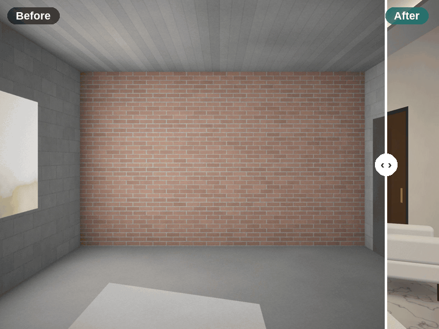

**[Try the live demo »](https://roshanshaji786.github.io/house_baithul_hamd/)** · [User guide](docs/USER_GUIDE.md) · [How it works](docs/ARCHITECTURE.md) · [Report a bug](https://github.com/roshanshaji786/house_baithul_hamd/issues/new/choose)

</div>

---

## Why this exists

Building a house takes years, and the hardest part is **imagining the finished home while you're standing in a shell of bare blockwork**. Which floor? What colour? Will a dark feature wall make the room feel small? Interior designers and 3D visualisers are expensive, and most "AI interior" apps need an account, upload your photos to a server, and ignore the room you actually have.

**Shell to Home** takes you from that bare shell to a finished home on screen. It works with *your* photos and *your* room's real shape. It runs free in your browser, and your photos never leave your device. The repository is named after *Baithul Hamd*, the house it was made for.

> **Why "Shell to Home"?** Builders call a house with walls and a roof but no finishes a *bare shell*. This app shows the journey from shell to home, before the first tile is laid.

## One photo, five styles

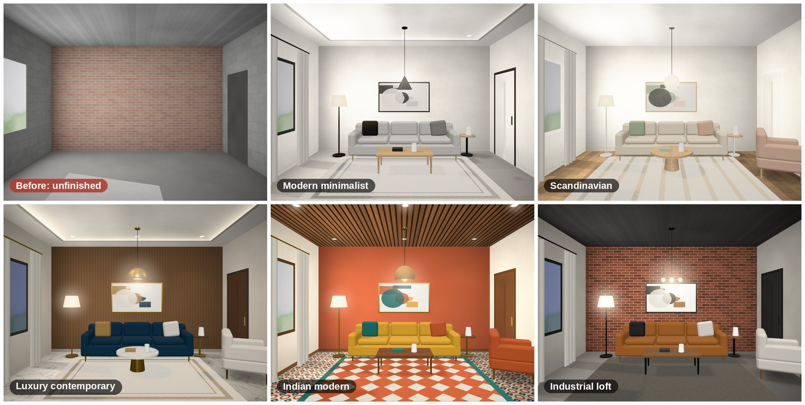

## Every room, and the outside too

| | |
| --- | --- |
| 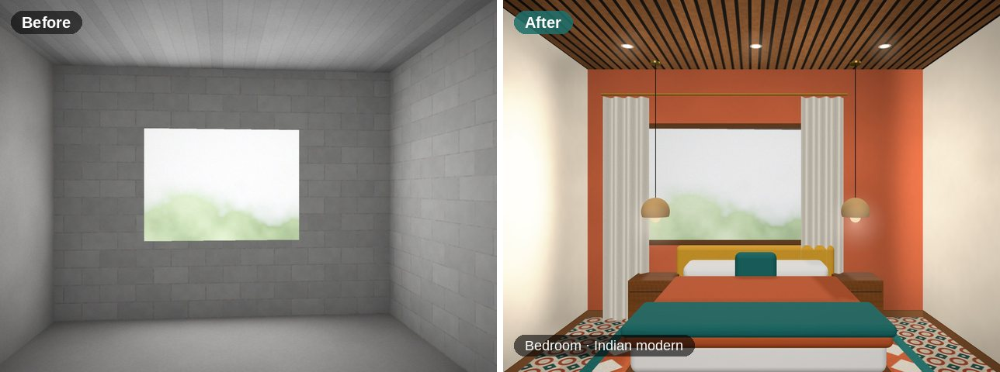 | 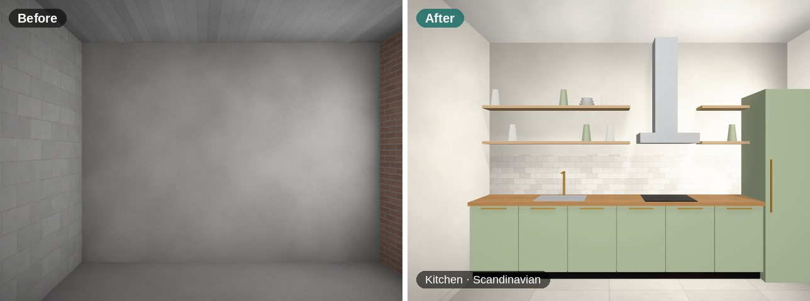 |
| 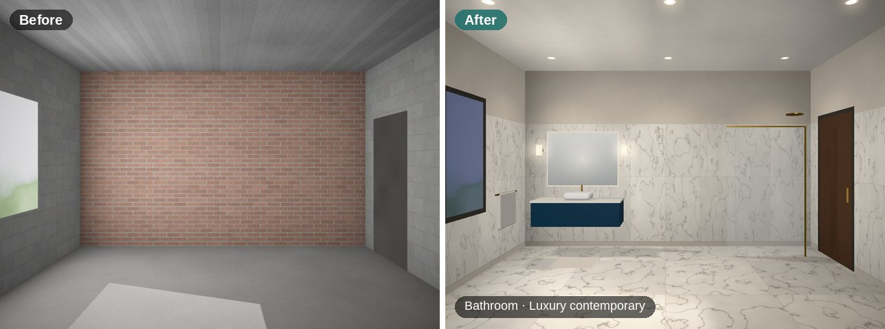 | 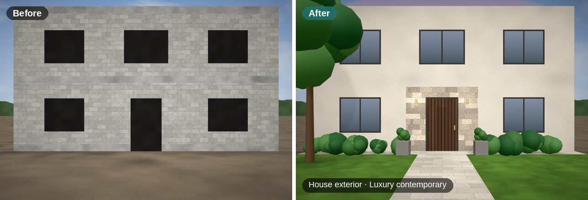 |

## Walk through your future home in 3D

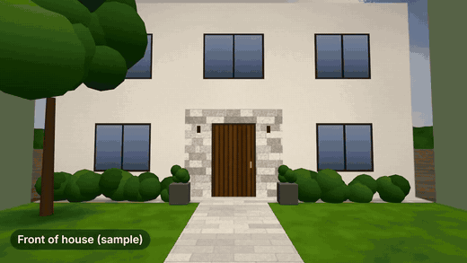

Every rendered room becomes part of a **3D house**. Preview the walkthrough in your browser, orbit around a dollhouse view, and download it as an **MP4 video** to send to family or your builder, or as a **3D model (.glb)**.

## Features

- 📷 **Drag-and-drop photos** of rooms or the full house exterior, with thumbnails and clear messages when a photo is **too small, too dark, blurry or unclear**.
- 🎨 **Five preset styles**: modern minimalist, Scandinavian, luxury contemporary, Indian modern, industrial loft.
- 🖼️ **Up to 5 reference images**, each with a label and a **role**: *overall style, flooring, kitchen, colour palette* or *furniture*. Each role only changes its own part of the room, and every render lists **which references were used and how**.
- ⚠️ **Layout-safe**: if a reference doesn't fit your room's layout or scale, the app **keeps your photo's layout and tells you what it ignored**.
- ↔️ **Before/after slider**, side by side, or after only. Switching styles or swapping a reference updates the render without re-uploading.
- 🧱 **Edit one element at a time**: just the floor, the paint, the ceiling, the lighting, the fixtures, the kitchen cabinets or the furniture.
- 💾 **Save and download** every finished image, or a labelled before/after image ready for WhatsApp.
- 🏠 **3D house, walkthrough video (MP4) and 3D model (GLB)** that use the same style and references as your renders.
- 📱 **Mobile-friendly**, keyboard accessible, light and dark mode.
- 🔒 **Private by default**: no account, no upload. Projects are saved in your browser.
- 🤖 **Optional photo-real AI renders** with OpenAI or Google Gemini, and an AI reference check with Claude, when you self-host with your own API keys.

<details>
<summary><b>Screenshots</b></summary>

| Design workspace | 3D house & video | Mobile |
| --- | --- | --- |
| 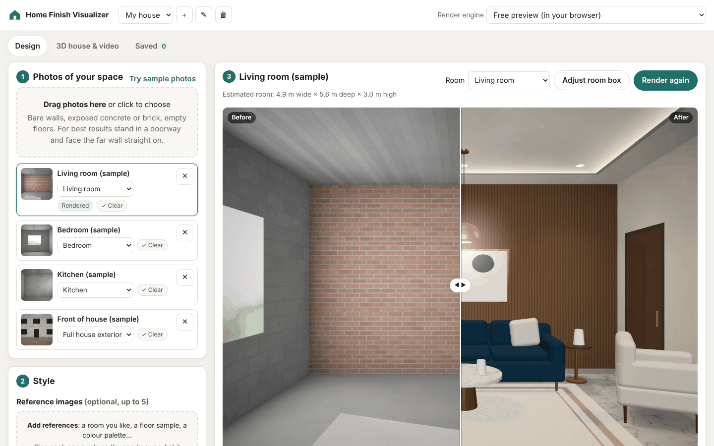 | 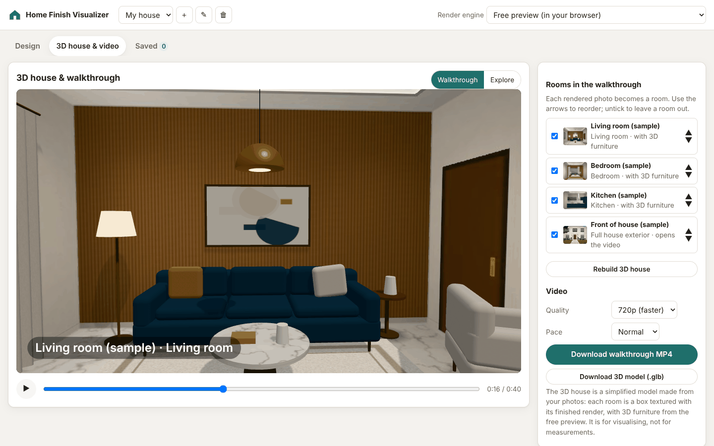 | 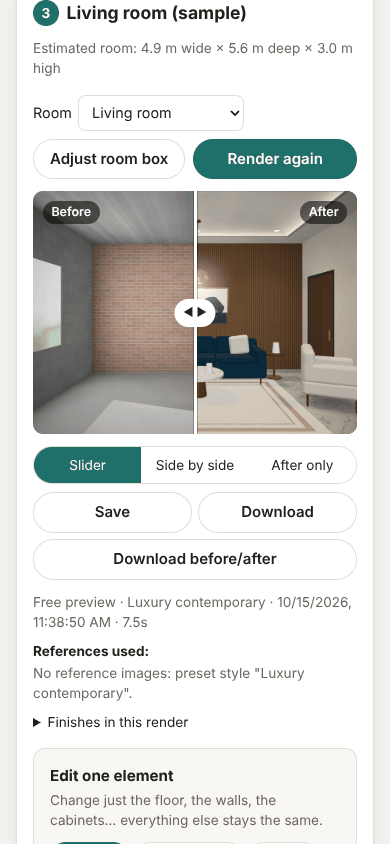 |

</details>

## Try it

### Option 1: Live demo (nothing to install)

**👉 [roshanshaji786.github.io/house_baithul_hamd](https://roshanshaji786.github.io/house_baithul_hamd/)**

Press **Try sample photos**, then **Render**. Everything runs in your browser: rendering, 3D, and video export in Chrome, Edge or Safari.

### Option 2: Run it yourself

You need [Node.js](https://nodejs.org) 20.12 or newer.

```bash
git clone https://github.com/roshanshaji786/house_baithul_hamd.git
cd house_baithul_hamd
npm install
npm start
```

Open **http://localhost:3000**. No API keys are needed for the free preview.

To enable the optional AI engines, copy `.env.example` to `.env`, add the keys you want and restart. To use the app from your phone on the same Wi-Fi, run `HOST=0.0.0.0 npm start`. Only do this on a network you trust: anyone on it could use your API keys.

### Option 3: Host your own copy

`npm run build:static` creates `dist/`, a static site you can put on GitHub Pages, Netlify or any web host. Forks get a GitHub Pages deployment automatically from [`.github/workflows/pages.yml`](.github/workflows/pages.yml): enable *Settings › Pages › Source: GitHub Actions*.

## How it works (in 30 seconds)

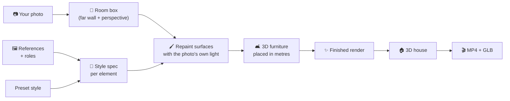

1. **Room box.** The app finds the far wall and the vanishing point, then works out the room's size in metres and what every pixel shows: floor, wall or ceiling. You can fine-tune this with **Adjust room box**.
2. **Repaint with real light.** Each surface gets its new material in correct perspective, multiplied by the light and shadow from your own photo, so it still looks like *your* room. Windows keep their view, doorways get doors, and ceilings get cove lights or downlights.
3. **Furniture in 3D.** Sofas, beds, kitchens, vanities, curtains and plants are placed in real metres, never in front of a doorway, and rendered with three.js through the same camera.
4. **3D house.** Each finished image is projected back onto a 3D box of the room ("tour into the picture"), so you can walk in.

Details: [docs/ARCHITECTURE.md](docs/ARCHITECTURE.md).

## Render engines

| Engine | Cost | Best for |
| --- | --- | --- |
| **Free preview** (default) | Free, runs in your browser | Fast, private, consistent previews. Works best with straight-on photos. Stylised rather than photo-real. |
| **OpenAI** (`gpt-image-1`) | Paid API, self-hosted only | Photo-real renders. Single-element edits of the floor, walls or ceiling use a mask so only that area changes. |
| **Google Gemini** (`gemini-2.5-flash-image`) | Paid API, self-hosted only | Photo-real renders that blend several role-tagged references well. |

Both AI engines are told to keep your photo's camera, room shape, windows and doors, and never to copy logos, brands or trademarked products.

## Features that need a paid API or service

Everything else is **free and local**: the free preview renderer, image checks, reference analysis and conflict warnings, element editing, saving, the 3D house, walkthrough preview, MP4 export and GLB export.

| Feature | Service | `.env` setting |
| --- | --- | --- |
| Photo-real AI renders and AI single-element edits | **OpenAI Images API** (paid per image) | `OPENAI_API_KEY` (optional: `OPENAI_IMAGE_MODEL`, `OPENAI_IMAGE_QUALITY`, `OPENAI_INPUT_FIDELITY`) |
| Photo-real AI renders and AI single-element edits | **Google Gemini API** (paid per image) | `GEMINI_API_KEY` (optional: `GEMINI_IMAGE_MODEL`) |
| AI reference check: deeper layout/scale conflict detection plus a style brief for AI prompts | **Anthropic Claude API** (paid per request) | `ANTHROPIC_API_KEY` (optional: `ANTHROPIC_MODEL`, default `claude-opus-5-5`) |

Not included, but possible with paid services: **true 3D scanning** from many photos (photogrammetry or Gaussian splatting, e.g. Luma AI, Polycam, Matterport), and **AI-generated cinematic video** (e.g. Runway or Google Veo).

MP4 export is free. Chrome, Edge and Safari encode in the browser (WebCodecs). Other browsers use the self-hosted server's [ffmpeg](https://ffmpeg.org), if installed.

## FAQ

<details><summary><b>Is it really free?</b></summary>

Yes. The preview, 3D walkthrough and MP4 export cost nothing and need no account. Only the optional photo-real AI engines cost money, billed by the provider to your own API key.
</details>

<details><summary><b>Are my photos uploaded?</b></summary>

No. They stay in your browser (IndexedDB). They are only sent anywhere if you self-host with an AI engine and choose it, and then only to that provider through your own server. API keys never reach the browser.
</details>

<details><summary><b>What photos work best?</b></summary>

Stand in the doorway, face the far wall straight on, hold the phone level, and shoot in daylight. See the [user guide](docs/USER_GUIDE.md#1-take-good-photos).
</details>

<details><summary><b>Can I use it for a client presentation?</b></summary>

Yes. Use one project per client, download before/after images, and send the walkthrough MP4. The MIT licence also lets you fork and rebrand it.
</details>

<details><summary><b>Is this a construction drawing?</b></summary>

No. Renders, videos and 3D models are **visual previews** with rough size estimates, not architectural, structural, electrical or engineering plans. Always check with qualified professionals.
</details>

## Roadmap

- [ ] Corner (two-point perspective) photos in the free preview
- [ ] More presets: Japandi, coastal, Kerala traditional, mid-century
- [ ] Furniture drag-and-drop in the 3D view
- [ ] Cost estimate per finish (materials list)
- [ ] Share a project as a link
- [ ] Translations (Hindi, Malayalam, Arabic…)

Have an idea? [Open a feature request](https://github.com/roshanshaji786/house_baithul_hamd/issues/new/choose). Contributions are very welcome; see [CONTRIBUTING.md](CONTRIBUTING.md).

## Project structure

```
public/            the web app (plain ES modules, no build step)
  js/render/       free preview renderer, materials, furniture, style specs
  js/three/        3D house, walkthrough, MP4 export
  js/ui/           panels, compare slider, room box, element editor
server/            Express server: AI providers, prompts, ffmpeg video fallback
docs/              user guide, architecture, launch kit, images
scripts/           static build for GitHub Pages
test/              unit tests (npm test)
tools/             sample photo generator
```

## Development

```bash
npm run dev            # server with auto-restart
npm test               # unit tests (geometry, styles, conflicts, furniture, prompts, AI adapters)
npm run test:browser   # end-to-end tests in a real headless Chromium (WebGL via SwiftShader)
npm run test:all       # both suites
npm run build:static   # static site in dist/
```

The browser tests need no installation or GPU: a headless Chromium with software WebGL
ships as the devDependency `@sparticuz/chromium` and is unpacked on first run. They cover
the full user journey — uploading, quality checks, rendering every room type, the before/after
slider, single-element edits, projects, the 3D house, MP4/GLB export, persistence, the
static build used on GitHub Pages, and a mobile viewport (no horizontal overflow, sticky
tabs, touch input).

## Disclaimer

Images, videos and 3D models from this app are **visual previews** for homeowners and small contractors. They are not architectural, structural, electrical, plumbing or engineering drawings, and room sizes are estimates. Reference images are used for style only; the app does not copy trademarked products or logos.

## Acknowledgements

Built with [three.js](https://threejs.org), [mp4-muxer](https://github.com/Vanilagy/mp4-muxer) and [Express](https://expressjs.com). Sample photos are generated procedurally by [`tools/make_samples.py`](tools/make_samples.py), so they carry no licence restrictions.

## License

[MIT](LICENSE) © roshanshaji786

<div align="center">

**If Shell to Home helped you picture your future home, please ⭐ star the repo and share your before/after with `#ShellToHome`.**

</div>
