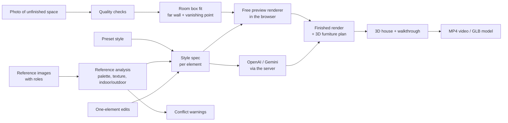

# Architecture

How Shell to Home works under the hood. For using the app, see the [user guide](USER_GUIDE.md).

- [Overview](#overview)
- [Code map](#code-map)
- [Data model](#data-model)
- [Style specs](#style-specs)
- [Free preview renderer](#free-preview-renderer)
- [AI engines](#ai-engines)
- [3D house and video](#3d-house-and-video)
- [Server API](#server-api)
- [Static build](#static-build)
- [Testing](#testing)

## Overview



- The **browser app** (`public/`) is plain ES modules with no build step. It uses [three.js](https://threejs.org) for 3D and [mp4-muxer](https://github.com/Vanilagy/mp4-muxer) for video files.
- The **Node server** (`server/`, Express) serves the app, keeps API keys secret, calls the AI providers and offers an ffmpeg fallback for MP4 encoding.
- Without the server (for example on GitHub Pages) everything except the AI engines still works.

## Code map

| Path | Purpose |
| --- | --- |
| `public/js/main.js` | Start-up: load the saved project, ask the server for capabilities, start the UI |
| `public/js/state.js` | Project store (auto-saved to IndexedDB) and runtime caches |
| `public/js/catalog.js` | Room types, reference roles, elements, presets. **Shared with the server.** |
| `public/js/lib/geometry.js` | Room box maths: camera model, ray casting, room size, far-wall detection, box blur |
| `public/js/lib/imageTools.js` | Image loading, quality checks, k-means palettes, colour helpers |
| `public/js/lib/db.js` | Small IndexedDB wrapper |
| `public/js/render/styles.js` | Style specs: presets → references (by role) → one-element edits, plus text descriptions |
| `public/js/render/references.js` | Reference analysis and layout/scale conflict checks |
| `public/js/render/materials.js` | Procedural, tileable materials with mip-mapped samplers |
| `public/js/render/localRenderer.js` | The free preview renderer |
| `public/js/render/furniture.js` | Furniture planning in metres, and three.js models |
| `public/js/render/engine.js` | One "render this photo" entry point for every engine |
| `public/js/three/house.js` | 3D house construction and walkthrough timeline |
| `public/js/three/videoExport.js` | MP4 export (WebCodecs, or frames to the server) |
| `public/js/ui/*.js` | Upload panels, workspace, compare slider, room box editor, element editor, 3D tab |
| `server/index.js` | Express app, API routes, rate limiting |
| `server/prompt.js` | Prompts for AI image models |
| `server/providers/*.js` | OpenAI, Gemini and Claude adapters |
| `server/video.js` | ffmpeg job manager |
| `scripts/build-static.mjs` | Static build for GitHub Pages or any web host |
| `tools/make_samples.py` | Generates the sample photos (numpy ray-caster) |

## Data model

A **project** (one per house or client) is stored in IndexedDB:

```js
{
  id, name, styleId, engine,             // 'local' | 'openai' | 'gemini'
  photos: [{ id, name, blob, width, height, roomType, fit, quality, useAnyway, overrides, aiCheck }],
  references: [{ id, label, role, blob, quality }],   // up to 5
  renders: [{ id, photoId, blob, finishBlob, plan, engine, model, styleId, referencesUsed, warnings, elements, element, key, saved }],
  house: { order: [photoId], excluded: [photoId] },
}
```

- `fit` holds the room box: the far-wall rectangle and vanishing point (as 0–1 fractions of the image) and the lens.
- `overrides` holds one-element edits, e.g. `{ walls: { paint: '#e9e2d6' } }`.
- `key` is a fingerprint of every input of a render. When it no longer matches the current settings, the render is shown as out of date.
- Saved renders, plus the latest six per photo, are kept to limit storage.

## Style specs

`resolveSpec()` produces a spec with one entry per element: `flooring`, `walls`, `ceiling`, `lighting`, `fixtures`, `cabinets` and `furniture`. It is built in three layers:

1. **Preset**, adapted to the room type (bathrooms get wall tiles, kitchens get splashbacks, exteriors get facade, paving and sky).
2. **References**, by role. Each role writes only to the elements it controls. Colours come from a k-means palette (light neutral → walls, main colour → upholstery, most vivid → accents, warm brown → wood). An "overall style" reference also samples its floor area to pick a floor type. A uniform "flooring" close-up becomes a seamless texture. A second reference with the same role is skipped, and the user is told.
3. **One-element edits**, which always win.

`describeSpec()` turns the spec into short English descriptions ("light oak planks", "walls painted warm white (#f4f1ea)…"). These are used both for AI prompts and in the UI.

## Free preview renderer

`localRenderer.js` runs in four steps.

**1. Analyse (cached per photo and fit).** From the fit, `solveRoom()` recovers a camera, assuming a 68° horizontal field of view for the phone's main lens and a 1.5 m camera height:

```
depth   = f · h / (v_bottom − c_y)          (far wall distance)
ceiling = h + (c_y − v_top) · depth / f
x_left  = (u_left − c_x) · depth / f,  x_right likewise
```

Every pixel's ray is intersected with the five box planes. This gives its surface, its position on that surface in metres, and its texture footprint (used for mip-mapping). The photo's luminance is blurred **per surface** with a normalised box blur, so the light on one surface doesn't bleed into the next. Openings are found as connected regions much brighter than their wall (windows with daylight) or much darker (unlit doorways), and kept as rectangles in metres.

**2. Compose.** Each pixel = material albedo × the photo's normalised shading × light level. Then:

- Windows keep the real view, with frames added. Doorways get doors. Skirting, wall tiles, kitchen splashback bands and the far feature wall are drawn.
- Ceilings can be flat, cove (bulkhead, shadow gap and glow), timber slats, or exposed concrete that keeps the photo's own surface detail.
- Downlights add a disc on the ceiling, plus pools of light and wall scallops: a cone falloff × Lambert ÷ distance².
- For exteriors the sky is replaced (trees and roofs are kept), and the ground becomes a lawn with a paved path to the detected front door.

**3. Furniture.** `planRoom()` places items in metres. It finds free spans on each wall (doorways are always avoided; windows only block items taller than their sill), adds curtains at windows, and chooses a layout per room type (sofa, rug and coffee table; bed and nightstands; kitchen run, hob and island; vanity, mirror and shower; planting for exteriors). `buildRoomObjects()` turns the plan into three.js meshes. These are rendered through a camera with the photo's off-centre principal point, with shadow-catcher planes and contact shadows, then alpha-composited onto the image.

**4. Grade.** Gentle auto-exposure, white balance by colour temperature, highlight bloom, vignette and a soft highlight shoulder.

The renderer also outputs a **wider, furniture-free finish image** (the same camera with the image area extended by 60% on each side). The 3D house uses it, so walls stay textured when the camera turns.

## AI engines

`engine.js` sends the photo (or, for one-element edits, the current render) plus the references to `POST /api/render`. `server/prompt.js` builds the prompt:

- **Layout rules** first: keep the camera, geometry and openings; ignore the references' layout; no logos or brands.
- The **style** and the optional **style brief** from the Claude reference check.
- A numbered list of reference images, each with its role's instruction ("use its material, colour, pattern and finish for the floor only").
- One line per element from `describeSpec()`.

One-element edits use `buildEditPrompt()` ("Change ONLY the flooring to…"). For floor, wall and ceiling edits, OpenAI also receives a **mask** generated from the room geometry.

| Provider | Endpoint | Notes |
| --- | --- | --- |
| OpenAI | `POST /v1/images/edits` (multipart) | `image[]` = photo + references, optional `mask`, `input_fidelity`, size picked from the photo's aspect ratio |
| Gemini | `models/{model}:generateContent` | Images are interleaved with labels ("Image 2 (reference "Oak", role: Flooring)"); `imageConfig.aspectRatio` is set to the nearest supported ratio |
| Claude | Messages API with `output_config.format` JSON schema | Returns `photo_issue`, `style_brief` and per-reference conflicts. Server-side fallback is enabled for refusals. |

## 3D house and video

`house.js` builds each room as five subdivided quads (floor, ceiling, left, right, back). Their UVs **project the finish image from the original camera position**, a camera-projection technique also known as "tour into the picture". Faces start where the texture covers them, so surfaces the photo never saw are left open as a dollhouse cutaway instead of being smeared. Free-preview rooms get their 3D furniture and shadows. Rooms are placed side by side with their far walls aligned; an exterior is placed separately for the opening shot.

The **timeline** is a list of shots: exterior approach → house overview orbit → one walk per room (a slow dolly forward with a left-to-right pan) → closing pull-back with the disclaimer card. It adds fades to black between shots and captions. The camera starts each room walk far enough in that the edges of its view stay on textured surfaces.

**MP4 export** renders every frame at 30 fps into a 2D canvas (3D render plus overlays). It then:

1. Encodes H.264 with **WebCodecs** (`VideoEncoder`) and packages it with **mp4-muxer** (`fastStart: 'in-memory'`). Encoding is throttled by `encodeQueueSize`.
2. If WebCodecs can't encode H.264, sends JPEG frames in batches to the server, which pipes them into **ffmpeg** (`image2pipe` → libx264, yuv420p, `+faststart`).

**GLB export** uses three.js's `GLTFExporter`, with helpers such as labels, outlines, shadow catchers and the ground hidden.

## Server API

| Method and path | Body | Response |
| --- | --- | --- |
| `GET /api/config` | – | Which providers, analysis and server video encoding are available. Never includes keys. |
| `POST /api/render` | `{ provider, base, references[{label, role, image}], mask?, aspect, brief }` (images as data URLs) | `{ image, model, prompt }` |
| `POST /api/analyze` | `{ photo, references[], roomType }` | `{ photoIssue, styleBrief, conflicts[{index, message}] }` |
| `POST /api/video/jobs` | `{ fps }` | `{ id }` |
| `POST /api/video/jobs/:id/frames` | concatenated JPEG bytes | `{ ok }` |
| `POST /api/video/jobs/:id/finish` | – | `video/mp4` |
| `DELETE /api/video/jobs/:id` | – | `{ ok }` |

Safeguards:

- The server listens on `127.0.0.1` unless `HOST` is set.
- AI routes are rate-limited in memory to 40 requests per 10 minutes per IP.
- Images must be JPEG, PNG or WebP data URLs of 12 MB or less.
- Errors are turned into friendly messages.
- Video jobs are limited to two at a time, 15 minutes each and 1.5 GB of frames.

## Static build

`npm run build:static` copies `public/` and the browser libraries into `dist/` and writes `.nojekyll`. With `SITE_URL` set, it rewrites the canonical, Open Graph and sitemap URLs. All app paths are relative, so it works under a sub-path such as `/house_baithul_hamd/`. Without a server, `api/config` fails gracefully and only the free engine is offered. `.github/workflows/pages.yml` deploys it to GitHub Pages on every push to `main`.

## Testing

`npm test` runs Node's built-in test runner on:

- `test/core.test.js`: geometry, quality checks, palettes, colour names, specs for every preset and room type, reference roles, overrides, conflict warnings.
- `test/furniture.test.js`: furniture stays inside the room, avoids doorways, adds curtains and kitchen splashbacks, follows downlight settings.
- `test/server.test.js`: prompt building, input validation, and the OpenAI, Gemini and Claude adapters against a stubbed `fetch` (the exact request shape and error handling).

CI (`.github/workflows/ci.yml`) runs the tests and the static build on every push and pull request.
